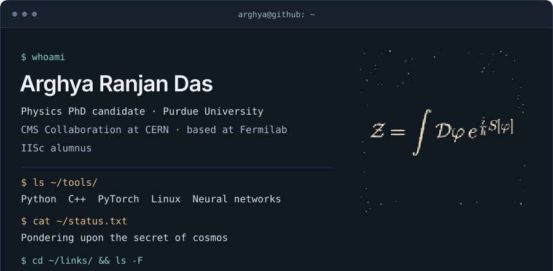
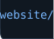
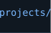
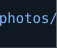
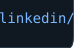

  <picture>
    <source media="(max-width: 1011px)" srcset="assets/terminal-mobile.svg" />
    
  </picture> 

  <picture>
    <source media="(prefers-reduced-motion: reduce) and (prefers-color-scheme: dark)" srcset="assets/github-snake-dark-still.svg" />
    <source media="(prefers-reduced-motion: reduce)" srcset="assets/github-snake-still.svg" />
    <source media="(prefers-color-scheme: dark)" srcset="assets/github-snake-dark.svg" />
    
  </picture>

